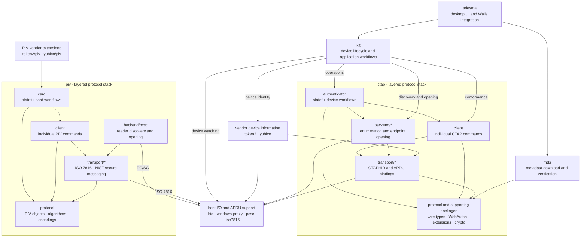

# Architecture

[← Telesma overview](README.md)

The diagram shows the desktop runtime and the layered CTAP and PIV stacks.
Arrows point from a consumer to a dependency; standalone tools and secondary
package imports are omitted.

`kit` uses vendor device information for FIDO2 discovery and identity. PIV
workflows use `piv` directly; `token2/piv` and `yubico/piv` extend its card
sessions with slot metadata, attestation, key import and generation with
PIN/touch policies, and administration commands.

