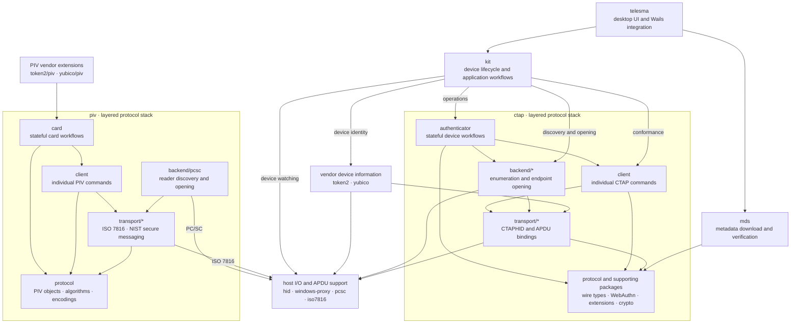

  

# Telesma

Telesma is an open-source desktop workbench for inspecting and managing local
FIDO2 authenticators, with a Go toolkit for FIDO2 and PIV applications. The
libraries cover CTAP 2.0–2.3, PIV, CTAPHID, ISO/IEC 7816-4, PC/SC, the Windows
WebAuthn API, and the FIDO Metadata Service.

## Projects

| Repository | What it provides |
|---|---|
| [`telesma`](https://github.com/telesma-app/telesma) | Wails 3 desktop workbench for inspecting and managing local FIDO2/CTAP authenticators. |
| [`cli`](https://github.com/telesma-app/cli) | Command-line example for building CTAP/FIDO2 tooling on the shared runtime. |
| [`stress`](https://github.com/telesma-app/stress) | Read-only USB CTAP2 stress testing with latency, throughput, and error reports. |
| [`kit`](https://github.com/telesma-app/kit) | Reusable discovery, session, operation, interaction, and safety workflows for authenticator applications. |
| [`mds`](https://github.com/telesma-app/mds) | Client for downloading and verifying FIDO Metadata Service (MDS3) data. |
| [`ctap`](https://github.com/telesma-app/ctap) | Layered CTAP 2.0–2.3 stack with stateful workflows, a command client, backend adapters, transports, and wire types. |
| [`piv`](https://github.com/telesma-app/piv) | PIV smart-card commands and workflows for certificates, PINs, key operations, and secure messaging over ISO 7816 and PC/SC. |
| [`iso7816`](https://github.com/telesma-app/iso7816) | Transport-independent ISO/IEC 7816-4 command and response APDUs, with optional GlobalPlatform SCP11b secure channels. |
| [`token2`](https://github.com/telesma-app/token2) | Token2 device information over PC/SC, USB HID feature reports, and CTAPHID; reader settings and PIV extensions. |
| [`yubico`](https://github.com/telesma-app/yubico) | Yubico management information and model identification over PC/SC and CTAPHID, plus PIV extensions. |
| [`winhello`](https://github.com/telesma-app/winhello) | cgo-free Go bindings for the Windows WebAuthn API and Windows Hello. |
| [`hid`](https://github.com/telesma-app/hid) | Cross-platform, cgo-free access to HID devices. |
| [`pcsc`](https://github.com/telesma-app/pcsc) | Minimal, cgo-free PC/SC access for smart cards and security tokens. |
| [`windows-proxy`](https://github.com/telesma-app/windows-proxy) | Windows service and named-pipe bridge for FIDO2 HID access without elevated application rights. |

## Architecture

The diagram shows the desktop runtime and the layered CTAP and PIV stacks.
Arrows point from a consumer to a dependency; standalone tools and secondary
package imports are omitted.

`kit` uses vendor device information for FIDO2 discovery and identity. PIV
workflows use `piv` directly; `token2/piv` and `yubico/piv` extend its card
sessions with slot metadata, attestation, key import and generation with
PIN/touch policies, and administration commands.

