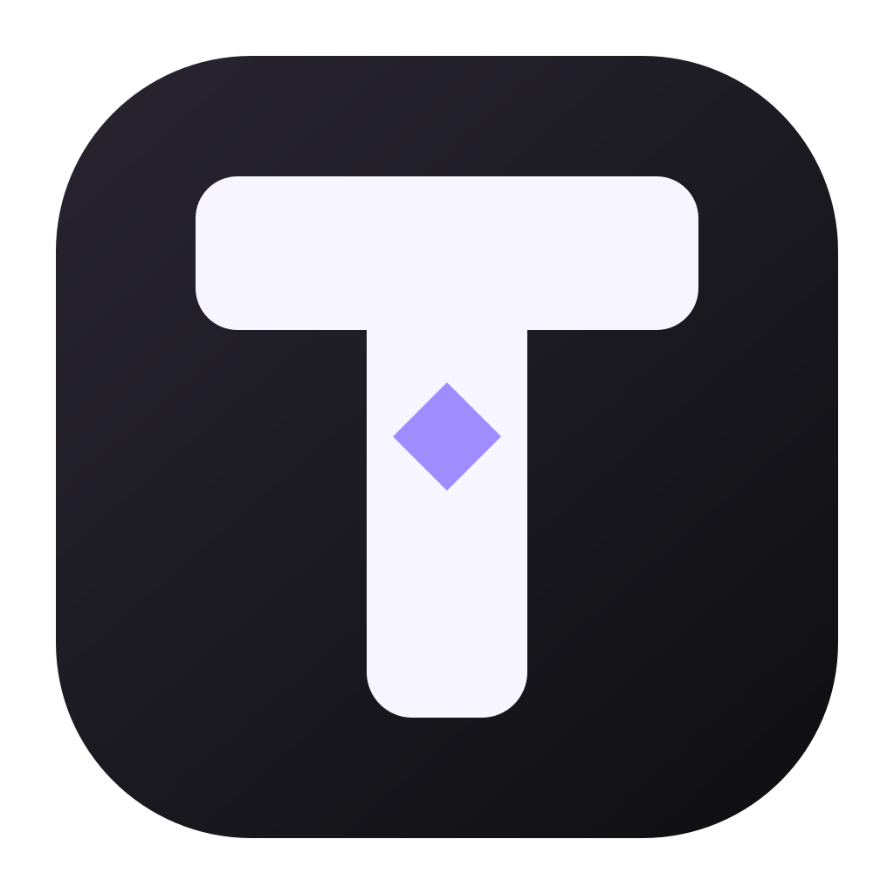

  

<h1 align="center">Telesma</h1>

  Tools for security keys. 
  A desktop workbench and Go libraries for FIDO2, PIV and OpenPGP smart cards.

## Desktop app

[**Telesma**](https://github.com/telesma-app/telesma) is a desktop workbench for
inspecting, testing and managing local FIDO2 authenticators.

- Inspect connected devices, capabilities and FIDO metadata.
- Manage discoverable passkeys, PINs and authenticator settings.
- Run WebAuthn credential creation and assertion scenarios and inspect the results.

See the [latest release](https://github.com/telesma-app/telesma/releases/latest)
for platform archives. Available operations depend on the connected authenticator.

## Go libraries

Use the application runtime or choose the protocol and platform libraries needed
by your project. Each repository documents its API, platform support and license.

| Libraries | Purpose |
| --- | --- |
| [`kit`](https://github.com/telesma-app/kit) | FIDO2 device discovery, lifecycle and application workflows |
| [`ctap`](https://github.com/telesma-app/ctap) | FIDO2/CTAP authenticator commands, transports and workflows |
| [`piv`](https://github.com/telesma-app/piv) · [`openpgp`](https://github.com/telesma-app/openpgp) | Smart-card commands, signing and key management |
| [`iso7816`](https://github.com/telesma-app/iso7816) · [`bertlv`](https://github.com/telesma-app/bertlv) | ISO 7816 APDUs, SCP11b channels and BER-TLV encoding |
| [`token2`](https://github.com/telesma-app/token2) · [`yubico`](https://github.com/telesma-app/yubico) | Vendor device information and PIV extensions |
| [`mds`](https://github.com/telesma-app/mds) · [`fido-registry`](https://github.com/telesma-app/fido-registry) | Verified FIDO metadata and registry types, mappings and validators |
| [`hid`](https://github.com/telesma-app/hid) · [`pcsc`](https://github.com/telesma-app/pcsc) | Cross-platform HID and PC/SC access |
| [`ble`](https://github.com/telesma-app/ble) | Experimental Bluetooth LE/GATT access on macOS |
| [`winhello`](https://github.com/telesma-app/winhello) | Windows WebAuthn and Windows Hello bindings |

See the [architecture overview](ARCHITECTURE.md) for how the projects fit together.

## Tools and services

- [`windows-proxy`](https://github.com/telesma-app/windows-proxy) — a Windows service
  for FIDO2 USB HID access from applications without elevation.
- [`stress`](https://github.com/telesma-app/stress) — USB CTAP2 stress testing with
  latency, throughput and error reports.
